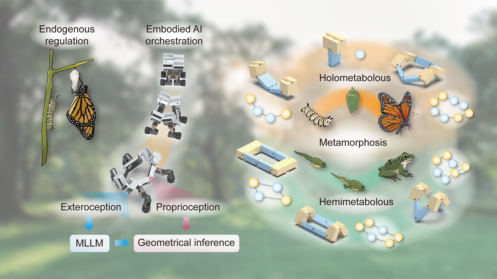
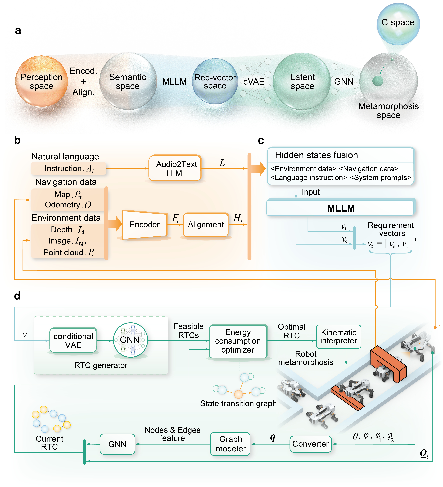

<div align="center">

  

</div>


## 🏠 Overview

This repository provides the code, data, and datasets accompanying the paper
*Metamorphous adaptability in robotic systems through intelligent structural evolvement*.

<p align="center">
  
</p>

**MIMA** connects multimodal requirement inference with configuration generation,
energy-aware selection and robot control. It maps task and environment inputs
to feasible robot topological configurations (RTCs), then converts selected
configurations into joint commands through the kinematic interpreter and planner.

<p align="center">
  
</p>

### Highlights

- **Multimodal requirement inference.** An MLLM maps multimodal observations
  and task instructions to a seven-dimensional requirement vector that guides
  robot reconfiguration.
- **Constraint-aware configuration generation.** A conditional VAE generates
  body-link poses and limb angles; graph imputation recovers the remaining pose
  fields, and a Scale GNN predicts external dimensions. Geometric and task
  constraints screen the resulting RTC candidates.
- **Energy-aware configuration selection.** The optimizer uses estimated
  transformation and sustainment energy to select a target RTC for execution
  through kinematic interpretation, motion planning and robot control.
- **Physical robot validation.** Indoor and outdoor experiments on the
  meta-Sarrus-based I-MR demonstrate structural reconfiguration and locomotion-mode
  switching for confined passages, steps and unstructured terrain.

---

## 📋 Table of Contents

- [🏠 Overview](#-overview)
- [📚 Installation](#-installation)
- [🤗 Downloads](#-downloads)
- [📁 Layout](#-layout)
- [🚀 Inference](#-inference)
- [🚆 Training](#-training)
- [🧪 Reproducibility](#-reproducibility)
- [🔗 Citation](#-citation)
- [👏 Acknowledgements](#-acknowledgements)
- [📄 License](#-license)
- [📬 Contact](#-contact)

## 📚 Installation

Clone the repository with Git LFS support:

```bash
git lfs install
GIT_LFS_SKIP_SMUDGE=1 git clone https://github.com/SIR-meta-control/MIMA.git
cd MIMA
```

Follow the [installation guide](docs/INSTALLATION.md) to configure the standalone
Python runtime, PyTorch generator environment and ROS 1 / Catkin workspace.

> [!NOTE]
> Generator inference and standalone evaluation can run on a CPU. The model
> service and ROS adapter can use separate Python environments, connected
> through the HTTP service.

Selected model checkpoints are ordinary Git files and are ready after cloning.
Fetch the Git LFS archives needed for your workflow using the
[downloads guide](docs/DOWNLOADS.md).

All standalone commands below run from the MIMA repository root unless a
section specifies another directory.

## 🤗 Downloads

The [downloads guide](docs/DOWNLOADS.md) covers selected generator checkpoints,
fitted requirement-vector baselines, Git LFS data archives, integrity checks
and dataset extraction. The [data inventory](data/README.md) lists the figure
source data, calibration records and split ROS bag.

The selected generator and RF/DT/GBT weights are included in the repository.

## 📁 Layout

The main source, model and data locations are shown below. The module datasets
and system bundle directories are created by the download preparation commands.

```text
MIMA/
├── src/
│   ├── generator/                  RTC generator service and ROS adapter
│   ├── graph_modeler/              MuJoCo geometry capture
│   ├── optimizer/                  Energy-based candidate selection
│   ├── kinematics_interpreter/     RTC-to-joint conversion
│   ├── trans_planner/              Transformation planning
│   ├── ros_mujoco/                 Simulation and energy calibration
│   ├── models/                    Crimson MJCF, URDF and meshes
│   ├── crimson_control/            Robot control
│   └── motor_interface/            Motor drivers and interfaces
├── MLLM/
│   ├── mima_requirement_vector/    Teacher/student clients and RF/DT/GBT weights
│   └── teacher_student/            Teacher/student source, features and services
├── experiments/
│   ├── module_level_ablation/
│   │   ├── checkpoints/selected/   Four selected generator checkpoints
│   │   ├── datasets/              Prepared training and validation data
│   │   └── outputs/               Archived module metrics and comparison table
│   └── system_level_ablation/
│       └── data_bundle/           Prepared system-level records
├── data/                          Git LFS archives and SHA-256 checksums
├── runs/                          Energy-analysis records and tools
├── scripts/                       Data preparation and repository checks
├── docs/                          Installation, downloads and reproduction guides
└── figure/                        Repository figures
```

The [documentation index](docs/README.md) links the guides, package interfaces
and experiment records.

Package-specific instructions are available in the linked READMEs for the
[generator](src/generator/README.md), [optimizer](src/optimizer/README.md),
[kinematics interpreter](src/kinematics_interpreter/README.md),
[planner](src/trans_planner/README.md), [multimodal inference](MLLM/README.md)
and [experiments](experiments/README.md).

## 🚀 Inference

### Generator Server

After installing the generator dependencies, start the local HTTP service:

```bash
python src/generator/scripts/generator_service.py \
  --host 127.0.0.1 --port 8091 \
  --model experiments/module_level_ablation/checkpoints/selected/cvae_gnn/best_model.pt \
  --bar-classifier experiments/module_level_ablation/checkpoints/bar_classifier/bar_classifier.pt \
  --device auto
```

The model is loaded once at startup and serves repeated requests. Use
`--device cpu` for CPU inference or `--device cuda` for a CUDA-enabled runtime.

### Generator Client

In a separate shell, check readiness and request candidate configurations:

```bash
curl http://127.0.0.1:8091/health

curl http://127.0.0.1:8091/generate \
  -H 'Content-Type: application/json' \
  -d '{"vreq": [0.8, 0.6, 0.5, 0, 0, 0], "top_k": 3, "seed": 7}'
```

The native request vector is `[dp, wp, hp, load, inspect, pack]`. The service also
accepts the seven-dimensional MIMA requirement vector through `v_r`. Request
fields, response layouts, ROS topics and adapter configuration are documented
in the [generator README](src/generator/README.md).

Teacher/student service clients and local RF/DT/GBT inference are described in
the [requirement-vector guide](MLLM/mima_requirement_vector/README.md).
The [teacher/student source guide](MLLM/teacher_student/README.md) covers the
85-dimensional feature extractor, service deployment, training and evaluation.

## 🚆 Training

The configuration-generator study includes four architectures:

- **Full generator:** cVAE with a topology-aware Scale GNN.
- **Scale GNN → MLP:** cVAE with a topology-free scale estimator.
- **cVAE → MLP:** deterministic request MLP with a Scale GNN.
- **cVAE + Scale GNN → MLP:** deterministic request MLP with a direct scale head.

Prepare the released training and validation datasets first:

```bash
python scripts/prepare_data.py module
```

The [module-level guide](experiments/module_level_ablation/README.md#retrain-the-architectures)
describes the training entry points and experiment setup. Reference launchers
and hyperparameters are provided under
[`scripts/runners/`](experiments/module_level_ablation/scripts/runners/).

> [!NOTE]
> Retraining produces new checkpoints, and fresh cVAE sampling can change
> candidate-level results across devices. Use archived table reconstruction
> to recover the reported values from the released records.

## 🧪 Reproducibility

The [reproduction guide](docs/REPRODUCIBILITY.md) covers archived table
reconstruction, selected-checkpoint evaluation, retraining and system-level
experiments, with their corresponding inputs and metric definitions.

For a first run requiring only Python's standard library, reconstruct the
module-level comparison table:

```bash
python experiments/module_level_ablation/scripts/eval/print_validation_table.py \
  experiments/module_level_ablation/outputs/validation_metrics.json \
  experiments/module_level_ablation/outputs/cvae_mlp_ablation_metrics.json \
  experiments/module_level_ablation/outputs/mlp_gnn_ablation_metrics.json \
  experiments/module_level_ablation/outputs/mlp_ablation_metrics.json \
  --csv-output experiments/module_level_ablation/reproduced/validation_metrics_table.csv
```

### Repository Checks

After installing the [development dependencies](docs/INSTALLATION.md#development-checks),
run the source, documentation and artifact checks:

```bash
python scripts/check_repository.py
ruff check .
ruff format --check .
```

The GitHub Actions workflow runs these checks on pushes and pull requests.

## 🔗 Citation

If MIMA is useful for your research, please cite the accompanying manuscript:

```bibtex
@misc{mima,
  title={Metamorphous adaptability in robotic systems through intelligent structural evolvement},
  author={Chen, Qi and He, Jinghui and Huang, Yuehao and Zhu, Renjie and Tang, Zhao and Huang, Jiatai and Han, Youcheng and Feng, Xianming and Hu, Tianyang and Zhang, Jiangning and He, Haoyang and Fan, Dongliang and Liu, Yong and Paik, Jamie and Dai, Jian S.},
  note={Manuscript}
}
```

Machine-readable author and citation metadata are available in
[`CITATION.cff`](CITATION.cff).

## 👏 Acknowledgements

MIMA builds on the following research projects and open-source software:

- [InternVL](https://github.com/OpenGVLab/InternVL),
  [LLaVA](https://github.com/haotian-liu/LLaVA) and
  [LMDeploy](https://github.com/InternLM/lmdeploy) for multimodal modeling and inference.
- [Point-LIO](https://github.com/hku-mars/Point-LIO),
  [IKFoM](https://github.com/hku-mars/IKFoM) and
  [ikd-Tree](https://github.com/hku-mars/ikd-Tree) for LiDAR-based state estimation.
- [DynamixelSDK](https://github.com/ROBOTIS-GIT/DynamixelSDK),
  [libb64](https://github.com/libb64/libb64) and
  [WebSocket++](https://github.com/zaphoyd/websocketpp) for hardware and communication support.

Component attribution and retained license texts are documented in
[Third-party notices](docs/THIRD_PARTY_NOTICES.md).

## 📄 License

Original MIMA work is distributed under [GNU GPL v3.0](LICENSE.md).
Bundled third-party components retain their own licenses and notices.
Model weights, pretrained backbones and external datasets are subject to their
applicable provider terms. See the
[third-party notices](docs/THIRD_PARTY_NOTICES.md) and
[model card](docs/MODEL_CARD.md) for component and asset details.

## 📬 Contact

Questions, suggestions and reproducible bug reports are welcome through the
[project issue tracker](https://github.com/SIR-meta-control/MIMA/issues).
For maintenance questions, contact **<inorichen77@gmail.com>**.
